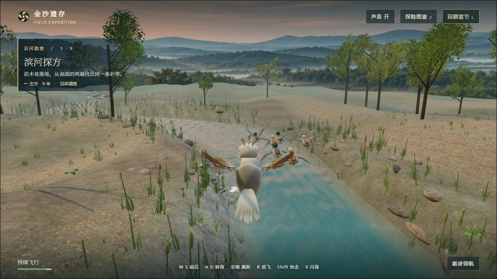

# 金沙：古蜀秘境

铜鸟的薄尾能承重吗？两根象牙在泥里原本是谁压着谁？跟随羽灵烁羽走过金沙古河岸的九处调查现场，用试托、摄影、拼合和测绘，亲手找出答案。旅程从辨认一片陶器口沿开始，在九柱基址的冬至晨光中结束。

**[下载网页试玩包](docs/v16/金沙古蜀秘境-网页试玩包.zip?raw=1)** · [观看 44 秒实机预告](docs/v16/发布物料/金沙古蜀秘境_实机预告_竖屏.mp4?raw=1) · [下载宣传物料](docs/v16/金沙古蜀秘境-小红书发布包.zip?raw=1)



## 开始游玩

完整解压试玩包。Windows 上准备好 Node.js 18 及以上版本或 Python 3，双击包内的 **启动试玩.cmd**。macOS 或 Linux 可在解压目录运行以下命令。

```sh
python3 -m http.server 5197 --bind 127.0.0.1 --directory site
```

保留服务窗口，在支持 WebGL 2 的浏览器打开 [本机试玩入口](http://127.0.0.1:5197/)。点击右上角「全屏体验」即可切换显示。进度保存在当前浏览器，首页可继续探索或「另启新旅程」，游戏内可重访已归档的章节。

| 想做什么 | 操作 |
| --- | --- |
| 沿河行进、翻越河汊 | W / S 前后移动，A / D 转身，Shift 快走，空格跳跃，R 切换持续飞行 |
| 辨认遗存、摄影留证 | E 调查，按各工位提示拖动或旋转器物。河岸上按 P 可另行取景，保存实景照片 |
| 查地图、比较证据、回顾章节 | J 打开图鉴，进入「证据推理台」。L 进入「回顾章节」。触屏可从河岸菜单进入 |

## 从源码运行

在仓库根目录使用 Node.js 22.12 或更高版本及 npm 执行以下命令。

```sh
npm ci
npm run build
npm run serve
```

生产构建入口是 [本机 5188 端口](http://127.0.0.1:5188/)。开发时可改用 `npm run dev`，访问本机 5186 端口。单元回归命令为 `npm test`。如需托管试玩，把解压包中 `site/` 的内容部署到静态站点根路径，保留资产目录结构。

## 项目与素材

[完整资产目录](ASSETS.md) 列出了运行文件、原始素材、配音母带、加工脚本和发布物料的位置。

| 位置 | 内容 |
| --- | --- |
| [src/](src/) | Three.js 场景、烁羽动作、九站交互、档案与摄影 |
| [public/](public/) | 角色模型、场景贴图、字体、乐器与环境声、21 段普通话角色配音 |
| [scripts/](scripts/) | 构建、资源处理、自动化测试与实机验收工具 |
| [发布物料](docs/v16/发布物料/) | 游玩录屏剪成的竖屏预告、实机截图、两幅 AI 辅助主题概念图与配套文案 |
| [版本与发布验收](docs/v16/版本与发布验收.md) | 九站通关、存档切换、四卷证据研判、摄影和解压试玩的验证记录 |

出土器物与遗迹资料可在游戏首页「考古依据」查阅。羽灵、可行走河岸和九柱建筑上部属于游戏创作与教学复原。第三方素材、字体和程序库沿用各自的许可与署名。[创作与素材署名](public/credits-v10.html) · [参考网站索引](public/references.html) · [仓库许可](LICENSE)
